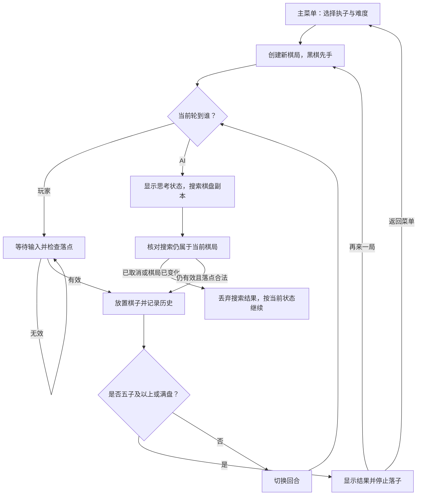

# 五子棋人机对战游戏提案

版本：0.2（讨论稿）  
日期：2026 年 10 月 28 日  
当前阶段：需求与工作流程设计；不编写游戏代码。

项目目录：`C:\Users\tyler\Desktop\VSCode\AI Gobang Game`  
开发编辑器：Visual Studio Code（VS Code）。提案检查确认并理解工作流程后，在此目录继续编写游戏代码。

**一、项目目标与已确认条件**

使用 C 语言制作一款简体中文的五子棋桌面游戏。玩家通过图形界面与 AI 对战，AI 使用 Minimax（极小极大搜索）及 Alpha-Beta（α–β）剪枝选择落点。

已确认：游戏与交流语言为简体中文；允许使用第三方图形库；不执行连珠禁手判罚；使用 VS Code 在上述项目目录开发；在提案检查确认、开发者理解工作流程之前不开始编写游戏代码。

本提案建议采用 C + raylib，先面向 Windows。Windows 为当前工作环境下的规划假设，最终交付平台仍需确认。编辑器已确定为 VS Code；C17 和 CMake 作为工具链建议，具体编译器、VS Code 扩展与课程要求待确认。

游戏目标是规则正确、交互清楚、AI 有基本攻防能力，并能在可控的思考时间内完成一局。AI 属于基于搜索与人工设计评分的程序，无需训练数据、模型下载或联网服务。

**二、规则约定**

| 项目 | 第一版约定 |
| --- | --- |
| 棋盘 | 15 × 15，共 225 个交叉点；棋子放在交叉点上 |
| 执子 | 黑棋先手；玩家可选执黑或执白 |
| 落子 | 双方轮流在空交叉点放一枚棋子，第一手位置不强制 |
| 获胜 | 横、竖、两条斜线中的任一方向，连续五子或以上即获胜 |
| 禁手 | 双方均不检查三三、四四与长连禁手；六子或更多连线也获胜 |
| 平局 | 棋盘已满且没有任何一方获胜；同一步先检查获胜，再检查满盘 |
| 其他 | 不吃子，不使用交换开局、强制开局、跳过回合或比赛计时规则 |

这是为本项目明确制定的“无禁手、五子及以上获胜”规则，不宣称实现正式连珠比赛规则。正式连珠对黑棋的长连、四四、三三另有判罚，因此不能仅写“取消禁手”而省略长连如何处理。[连珠规则参考](https://gomoku.renju.net/rifrules/)

**三、功能范围**

| 范围 | 功能 |
| --- | --- |
| 第一版必须完成 | 完整的人机对战、执子选择、简单／普通／困难三个难度、胜负与平局判定 |
| 第一版必须完成 | 简体中文菜单、规则说明、回合提示、AI 思考提示、最近落子标记、获胜连线高亮 |
| 第一版必须完成 | 悔棋、重新开始、返回菜单；会丢失当前棋局的操作先确认 |
| 第一版必须完成 | AI 搜索期间界面保持响应；取消搜索后不会出现迟到的落子 |
| 第一版必须完成 | 窗口缩放与点击坐标一致；鼠标操作和基本键盘操作 |
| 完成核心后再考虑 | 落子音效及静音、步数显示、最近一局记录或棋谱回放 |
| 后续扩展 | 保存与读取棋局、落子建议、棋局分析、主题切换 |

第一版聚焦本地人机对战。联网、账号、排行榜、机器学习和完整连珠规则留给独立的后续版本，避免挤占规则、搜索与交互的开发时间。

**四、界面与操作体验**

入口只保留“开始游戏”“游戏设置”“规则说明”“退出游戏”。开始前可以选择执子和难度；提供明确的默认选项，尽量减少进入棋局的步骤。

对局画面以棋盘为主，侧边显示“你：黑棋”“电脑：白棋”、难度、当前状态，以及“悔棋”“重新开始”“返回菜单”。木色棋盘、清楚的黑白棋子与充足留白作为初始视觉方向，具体外观在界面草图阶段讨论。

交互约定如下：

- 轮到玩家时，鼠标靠近合法交叉点显示半透明落子预览；一次点击只放一枚棋子。
- 只有落在棋盘有效范围内、靠近…”，关闭玩家落子输入；窗口仍能重绘，菜单和取消类操作仍可响应。
- 提示只显示真实状态，不显示无法可靠估计的“搜索完成百分比”。算法参数放在开发记录中，不占用普通玩家界面。
- 最近落子加形状标记；获胜时高亮连线并显示“你赢了”“电脑获胜”或“平局”，然后提供“再来一局”“返回菜单”。
- 方向键移动棋盘焦点，Enter 确认落子；按钮可通过键盘切换与确认。键盘焦点与鼠标悬停预览分别显示。
- 缩放窗口时保持棋盘比例，并用同一套布局坐标计算绘制与落点；窗口过小时采用最小尺寸限制或重新排列侧栏。

“悔棋”按玩家的一次决策定义：AI 尚未应答时，取消搜索并撤销玩家刚落的一子；AI 已经应答时，通常撤销 AI 与玩家最近各一子，让玩家重新选择。没有玩家落子可撤销时禁用按钮，例如玩家执白而棋盘上只有 AI 开局的一子。第一版在棋局结束后禁用悔棋，统一通过“再来一局”重新开始。

全部界面文案与源文件文本采用 UTF-8。随游戏打包可分发的中文字体及其许可说明，加载实际使用的中文、标点、数字和字母字形。raylib 提供 UTF-8、码点转换和指定字形的字体加载接口；中文显示仍需选择覆盖中文的字体并正确加载字形，不能只替换菜单文字。[raylib 字体接口](https://www.raylib.com/cheatsheet/cheatsheet.html)

**五、一局游戏如何运行**

核心顺序是：**收到输入或 AI 结果 → 检查是否允许 → 更新棋局 → 检查胜负 → 切换回合 → 刷新画面。** 玩家执白时，新棋局会直接进入 AI 回合。

程序通常一秒更新、绘制很多次画面，但只有合法落子才改变棋局。鼠标移动、按钮悬停、窗口缩放与 AI 思考提示都可以在等待下一枚棋子时持续更新。

**六、AI 如何选择落点**

Minimax 回答“应该选哪一步”，Alpha-Beta 剪枝减少为得到这个选择所需检查的分支，局面评估则在无法搜索到终局时估计局势。这三部分需要配合，单纯加上剪枝并不会自动得到强棋力。[Berkeley CS188 算法说明](https://inst.eecs.berkeley.edu/~cs188/textbook/games/minimax.html)

1. **检查直接获胜与立即威胁。** 自己一步能赢时优先获胜；否则识别对方下一步能获胜的位置，优先处理。对方存在多个不同的必胜落点时，可能已经无法靠一子同时挡住，不能把任意挡住一个描述成成功防守。
2. **产生候选落点。** 空棋盘上的 AI 开局优先选中心；其他局面先考虑已有棋子附近的空点，例如距离已有棋子横、纵坐标差均不超过两格的范围。距离和候选数量需实测调整，所有直接获胜和立即阻挡的位置必须保留。
3. **排列搜索顺序。** 优先搜索获胜、阻挡和形成威胁的落点，让剪枝更早发生。
4. **轮流模拟双方落子。** 每个分支先放一子，再进入下一层；返回上一层时撤销模拟落子。模拟只发生在搜索使用的棋盘中。
5. **到达终局或深度上限后评分。** 真正获胜、失败、平局用终局分值；未结束的局面用棋形评估。统一以 AI 的视角表示分值，高分对 AI 有利。
6. **用 Minimax 回传分值。** AI 回合选最高值；假设对手会作出最不利于 AI 的应对，因此对手回合取最低值。
7. **用 Alpha-Beta 跳过无须继续检查的分支。** 在相同的候选树、深度和评估规则下，正确剪枝保持 Minimax 的结果。主动删减候选落点则改变了搜索范围，可能漏掉远处的好棋，这与剪枝不同。
8. **迭代加深并控制时间。** 先完成浅层，再尝试更深一层；时间到时采用最近一次完整搜索的结果。搜索开始前准备一个合法备选落点，避免首层尚未完成就超时时无子可下。

“一层”表示任意一方落一子，不表示双方各下一手。深度 4 表示 AI、玩家、AI、玩家共四次落子。

可以用这个简化例子理解 Minimax。假设相同搜索深度下，分数越高越有利于 AI：

| AI 候选落点 | 玩家应对一的分数 | 玩家应对二的分数 | 对方最不利的应对结果 |
| --- | ---: | ---: | ---: |
| A | 80 | -10 | -10 |
| B | 20 | 15 | 15 |

AI 选择 B：对手认真应对时，B 的最坏结果比 A 好。若先搜索 B，已经知道它能取得 15；随后检查 A 时发现对手有办法把分数压到 -10，就不必继续检查 A 的其余应对。这是 Alpha-Beta 剪枝的直观作用。

局面评分先识别连五、活四、冲四、活三等棋形，再比较双方的威胁。活四可理解为连续四子两端都空，下一手有两个成五点；冲四有一个成五点。棋盘边缘按受阻处理。终局胜负必须高于任何普通棋形评分；同一棋形的重复计数和双方威胁的优先级需要通过固定局面验证。具体权重在理解棋形后讨论，不在提案中随意锁定。

三个难度使用相同的 Minimax + Alpha-Beta 框架，主要调整思考时间与最大深度。可先以简单 0.2 秒、普通 0.8 秒、困难 2 秒作为**待实测的搜索预算**；这些不是已验证的运行时间或棋力承诺。采用周期性时间检查，记录预算超出量，并根据目标电脑调整。有限深度、候选筛选和局面评分都会影响棋力，第一版不保证必胜。

**七、程序各部分如何配合**

| 模块 | 负责什么 | 为什么单独分开 |
| --- | --- | --- |
| 棋局与规则 | 棋盘、轮次、落子合法性、胜负、历史与悔棋 | 可以不打开图形窗口就验证规则 |
| AI | 候选落点、棋形评分、Minimax、剪枝与限时 | 调整棋力时不需要修改按钮或绘图 |
| 界面 | 棋盘、棋子、中文、按钮、预览、状态与结果显示 | 界面只提出操作请求，不自行改变规则 |
| 主流程 | 菜单与对局状态、调用规则、启动和接收搜索 | 统一决定何时能落子、何时该结束 |
| 资源与设置 | 字体、可选音效、难度与执子设置 | 方便打包，并集中处理资源加载错误 |

棋盘可以用二维数组表示空点、黑子、白子；另保存当前执子、玩家颜色、游戏结果与落子历史。数据表示将在讲解阶段画出来，再决定具体类型和接口。

为保持窗口响应，正式图形版本建议在后台任务中搜索，主线程持续处理输入和绘图。AI 接收棋盘副本与取消信号，只返回落点等结果；主线程核对棋局编号、当前轮次和落点合法性后，才把结果应用到真实棋盘。绘图与图形资源操作保持在主线程。

悔棋、重开、返回菜单和退出时都需要取消旧搜索；即使旧任务稍后返回，结果也必须丢弃。线程所用数据要保留到任务退出，并安全回收资源。具体线程接口待编译器确认后决定。分帧搜索是另一种可选实现，但不能只在界面上显示“思考中”然后长时间阻塞绘图循环。

**八、需要准备的工具、知识与素材**

| 类别 | 所需内容 |
| --- | --- |
| 开发工具 | VS Code、支持所选 C 标准的编译器、CMake、Git；VS Code 本身不包含 C 编译器，具体编译器及所需扩展在实现前确认 |
| 图形与资源 | raylib、可打包的中文字体；棋盘和棋子可直接绘制，无需先准备图片素材 |
| C 基础 | 二维数组、结构体、枚举、函数、指针、头文件与源文件的分工 |
| AI 基础 | 递归、搜索树、回溯、Minimax、α/β 边界、深度限制与局面评分 |
| 交互基础 | 事件或帧更新、坐标转换、应用状态、后台任务与取消 |
| 验证材料 | 固定的规则局面、AI 攻防局面、鼠标和窗口缩放操作记录 |

raylib 提供窗口、输入、绘图、字体与音频等游戏开发接口，适合本项目的二维棋盘；界面布局和交互仍需要自行设计。建议先保持依赖较少，确有需要时再增加其他界面库。[raylib 官方资料](https://www.raylib.com/)

**九、开发与学习顺序**

| 阶段 | 先理解什么 | 此阶段产出 | 进入下一阶段的条件 |
| --- | --- | --- | --- |
| 0：确认提案 | 规则、功能边界、一局流程、各模块职责 | 提案与界面草图；不写游戏代码 | 能说明一次落子会经过哪些步骤，并明确剩余环境限制 |
| 1：棋局规则 | 棋盘如何保存、如何沿四个方向判胜 | 可独立验证的规则模块与规则检查 | 四方向、边角、长连、非法落子、满盘与悔棋均正确 |
| 2：基本界面 | 鼠标坐标怎样变成棋盘坐标、状态如何驱动画面 | 可操作的棋盘和中文界面；临时由人工控制双方用于验证 | 可完整下一局，显示结果且不能继续落子 |
| 3：基础 AI | 候选点、模拟与撤销、统一评分视角、浅层 Minimax | 能下合法棋并处理基本攻防的 AI | 固定局面能直接获胜、阻挡唯一成五点，且搜索不改变原棋盘 |
| 4：剪枝与限时 | α/β、落点顺序、迭代加深、取消 | Alpha-Beta、搜索预算与后台搜索 | 同树同深度结果与 Minimax 一致；超时有合法结果，旧任务不会误落子 |
| 5：体验与交付 | 难度调节、反馈、键盘、缩放与资源打包 | 完整第一版、说明书和演示材料 | 在目标电脑上可启动并玩完一局，操作与资源检查通过 |

阶段 1 以后都属于未来的实现工作。当前只推进阶段 0；不会因为提案写完就自动开始写代码。讲解以“先看一个例子，再解释规则，最后由你复述”为节奏，不要求一次掌握整个 AI。

**十、如何判断完成**

- 规则：四个方向及棋盘边角均可正确判胜；双方六连也获胜；重复点击、越界和非本方回合不改变棋局；最后一子获胜时不会误判平局。
- 搜索：搜索前后原棋盘一致；固定局面能发现直接胜着与唯一必要阻挡；当自己能赢且对方也有威胁时优先结束比赛。
- 剪枝：在完全相同的候选树与深度下，Alpha-Beta 和无剪枝 Minimax 的最佳分值一致；同分时允许选择不同但同样最优的落点。用节点数量观察剪枝效果，不保证每个局面都节省相同比例。
- 响应：AI 思考时可移动窗口、重绘和操作允许的按钮；悔棋、重开或返回菜单后不会收到旧搜索落子。
- 体验：中文无缺字或乱码，焦点与预览清楚，缩放后点击仍准确，结束后不能继续落子。
- 难度：在同一电脑、相同局面集上记录搜索深度、节点数与耗时；通过战术局面与交叉执子的对局检查难度差异，而不是仅根据按钮名称认定棋力。
- 交付：打包可执行文件、运行所需库与字体、资源许可说明及中文操作说明；在不依赖开发目录的目标环境中验证启动与完整对局。

**十一、主要不确定点与控制办法**

| 问题 | 处理方式 |
| --- | --- |
| 搜索分支太多 | 候选生成、落点排序、Alpha-Beta、迭代加深与时间预算；同时检查候选筛选是否漏掉战术 |
| 分数高却下出坏棋 | 先处理真实终局与立即威胁；用固定棋形校验评估，再增加复杂棋形 |
| 有思考提示但窗口卡死 | 将搜索移出绘图循环，设计取消和旧结果丢弃机制 |
| 中文在开发机正常，打包后缺字 | 随包提供字体与字形列表，在目标环境检查字体加载与中文显示 |
| 功能越做越多 | 先交付表中第一版范围，再决定存档、回放等扩展 |

项目目录与 VS Code 已确定。目前仍需了解最终运行平台、具体 C 编译器、截止日期、是否有课程规定的语言标准与提交格式。现阶段可继续解释流程；这些信息会影响实现与排期，不妨碍先理解方案。

**十二、接下来的讨论**

建议先只走通一个场景：“玩家执黑，在中心落第一子，AI 思考并落下一子”。依次说明棋盘保存了什么、点击怎样变成落点、规则何时检查、AI 从哪里读棋盘，以及画面何时更新。

理解这个循环后，再单独展开二维棋盘与判胜，然后用一棵很小的搜索树讲解 Minimax 和 Alpha-Beta。待工作流程清楚、实现环境明确后，再开始阶段 1。
